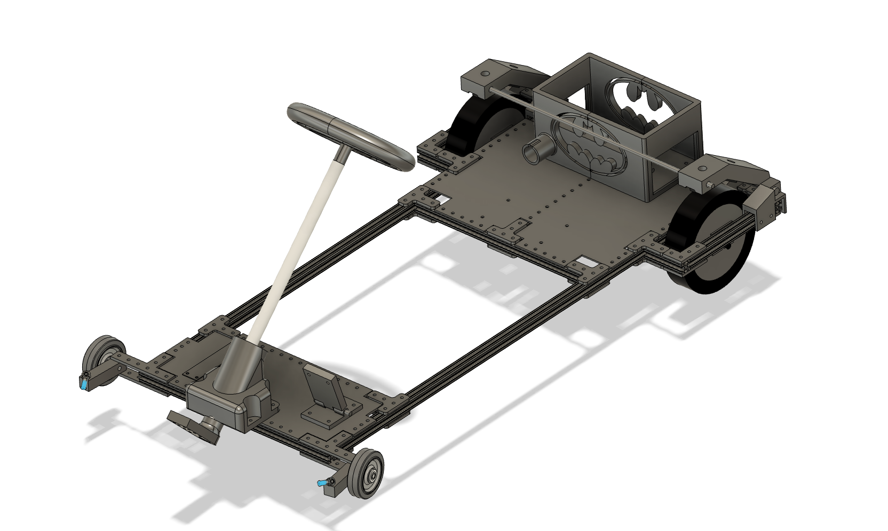
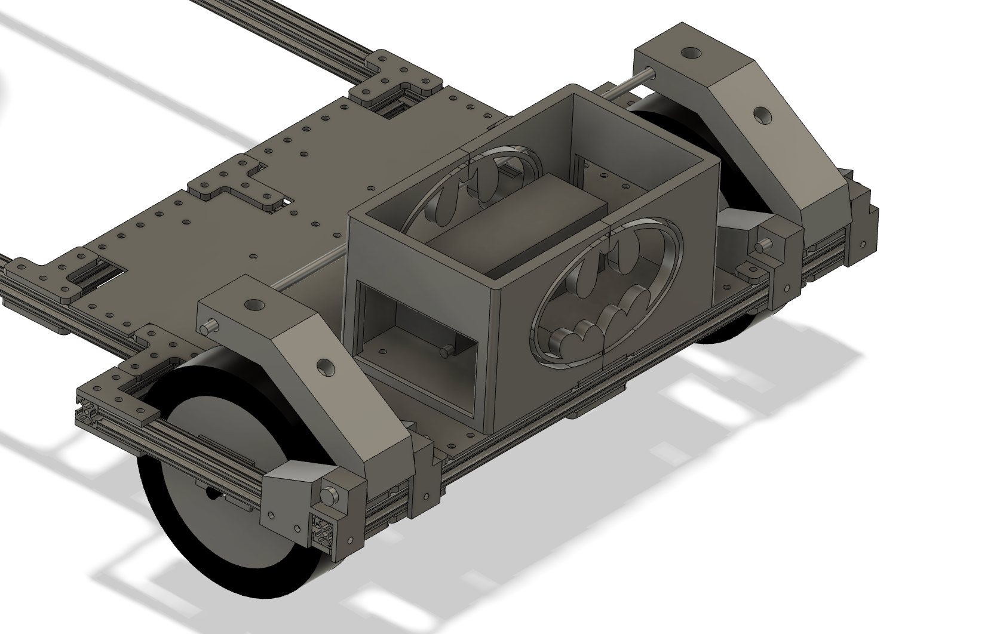
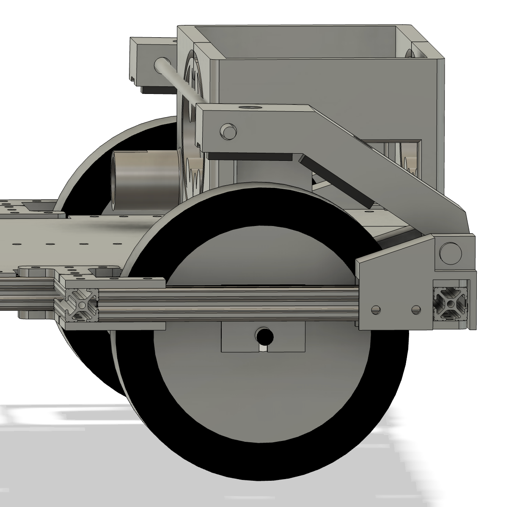
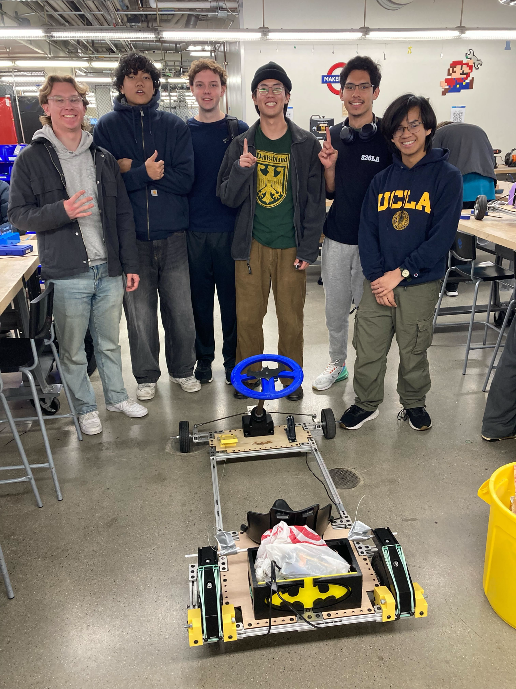

In UCLA's E96G: Go-Karts course, I built a go-kart from scratch with a team of six, using T-slot rails, motorized electric scooter wheels, 3D-printed components, and other parts provided by the course.

<video src="/files/go-kart/test-drive.mov" controls preload="metadata"></video>

*Me driving the go-kart around the final test course.*

My main task was to develop the braking system. It uses two 3D-printed brake calipers, each with two brake pads attached. A metal rod spans both calipers and is pulled down by a cable attached to the brake pedal. Rubber bands keep the brake pads up when the pedal is released.

*CAD assembly of the kart, designed in SOLIDWORKS.*

*My team and our Batman-themed kart.*
