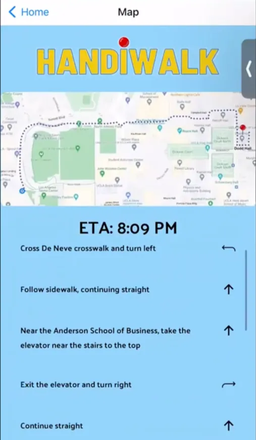

HandiWalk is a mobile app that makes UCLA's campus more accessible to handicapped students by providing convenient, accessible routes. My team developed it at the ACM HOTH X Hackathon, where it won **Best Beginner Project**. See our [Devpost](https://devpost.com/software/handiwalk) and [GitHub repository](https://github.com/EvanYZhao/HandiWalk).

Users enter their starting point and destination on the home page. The app then shows a map of the most convenient route, with an ETA and turn-by-turn directions.

*Maps page.*

<iframe src="https://www.youtube-nocookie.com/embed/uWJpxaWXdDI" title="HandiWalk video demonstration" allowfullscreen></iframe>
