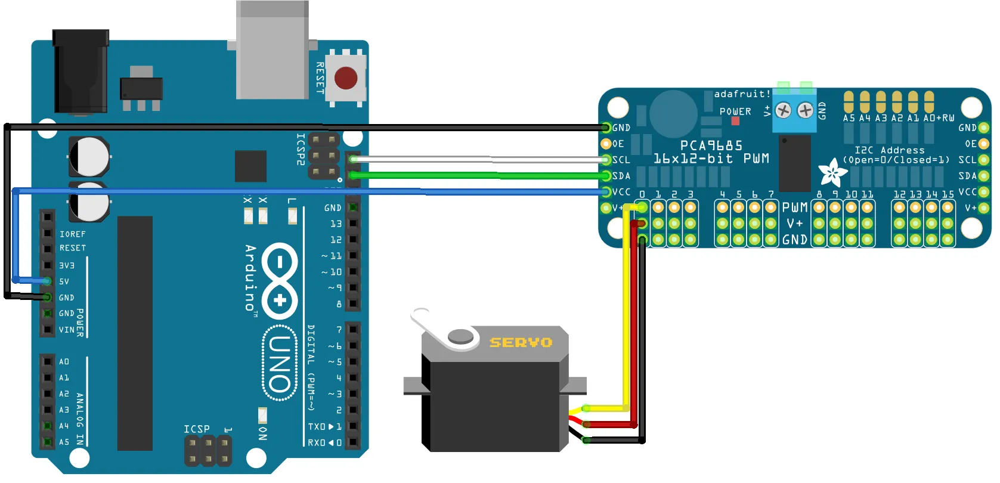
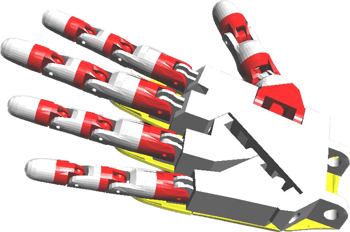
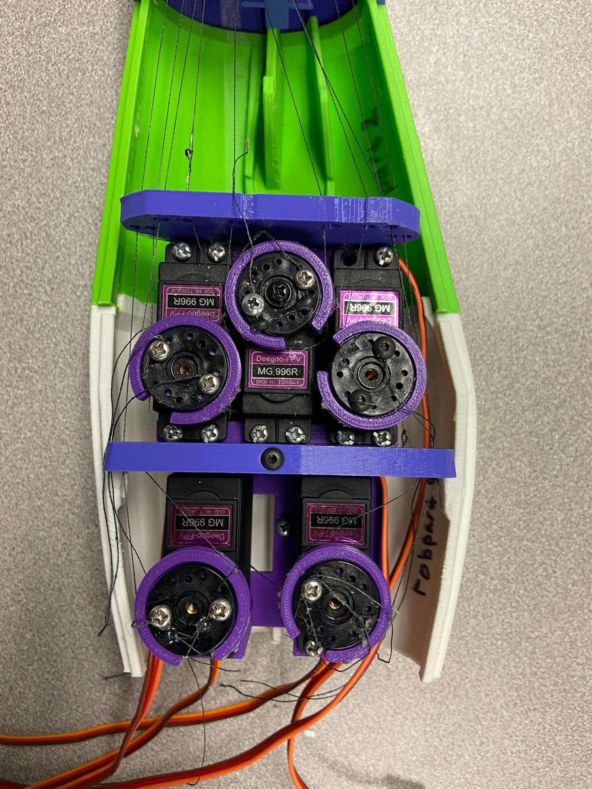
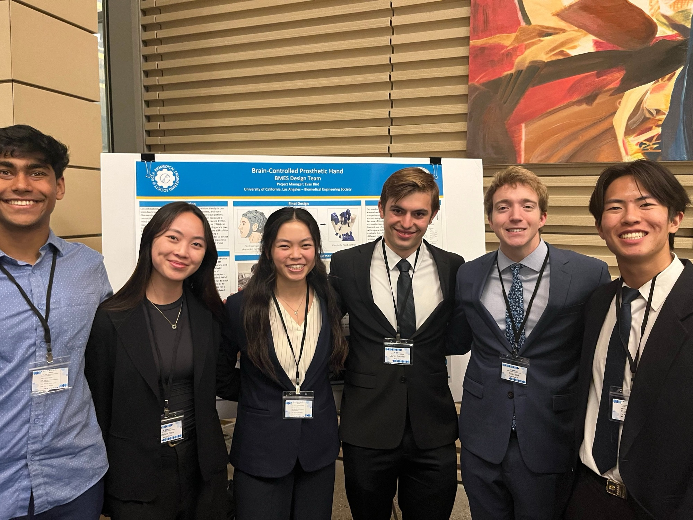

During my junior year, I developed a prosthetic arm actuated by a servo motor circuit. This project was part of the Biomedical Engineering Society (BMES) at UCLA's Design Team technical project.

The fingers are actuated by five MG966R servo motors, controlled by an Arduino and a PCA9685 servo driver.

*Servo motor circuit diagram.*

Our CAD model built on previous models found online, and the arm is made of 3D-printed components, screws, fishing wire, and super glue.

*CAD model.*

*Servo motor set-up.*

I led a sub-team in finishing this part of the project: the hand could open and close, as shown in the [demonstration video](https://drive.google.com/file/d/1X9exfn05t9Aq526WrX2T36pdx1t5i-Gg/view?usp=sharing).

Unfortunately, the EEG built by the team couldn't pick up any signals before our final presentation, so we didn't complete the full device. I'm still proud of the part my sub-team completed.

My team presented our work at the BMES Technical Projects Symposium in June 2024 with both an oral and a poster presentation:

- [Poster (PDF)](/files/mechanical-hand/poster.pdf)
- [Symposium slides (PDF)](/files/mechanical-hand/symposium-slides.pdf)

*My team at the Tech Projects Symposium!*
