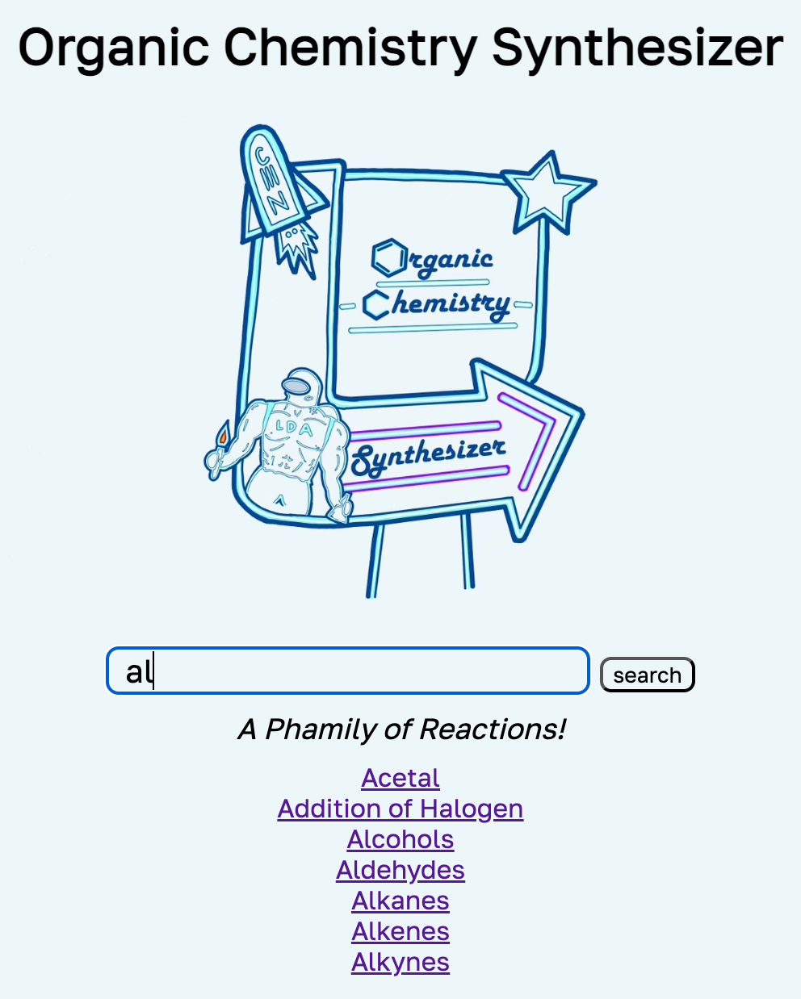
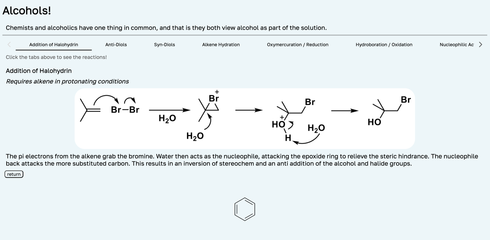
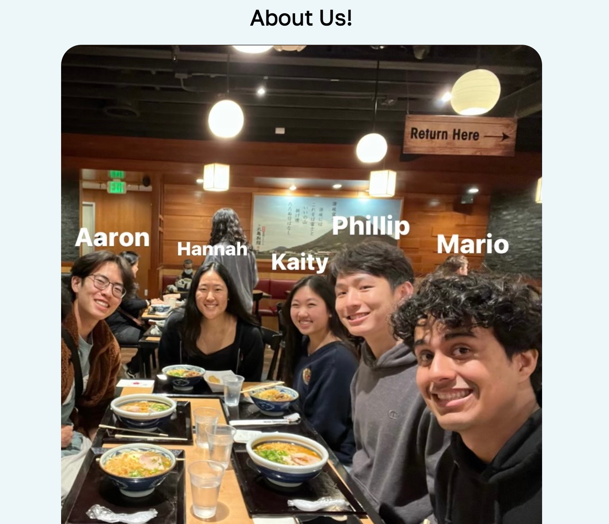

During my sophomore year, I took an organic chemistry course, Chem 14: Organic Reactions and Pharmaceuticals. The professors offered an extra credit project to stir up our creativity. Wanting to build on my new web development skills, I developed a website that serves as a study tool for organic chemistry reactions.

*Search bar.*

The site is built with React. Its search bar filters results as the user types.

Once a group of reactions is searched, an information page is displayed, with tabs to view other reactions from the same group.

*Reaction info page.*

The site also has an Easter egg: clicking the benzene ring at the bottom opens a page that tells you a little more about the group that worked on the project.

*About Us page.*

Try the [live website](https://aarznl.github.io/Organic_Chemistry_Search_Bar/) or browse the [GitHub repository](https://github.com/aarznl/Organic_Chemistry_Search_Bar).
