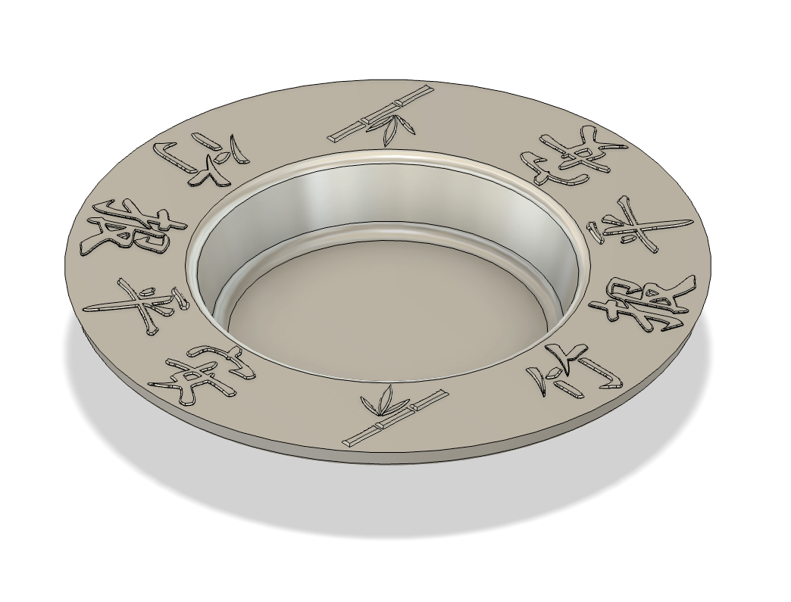
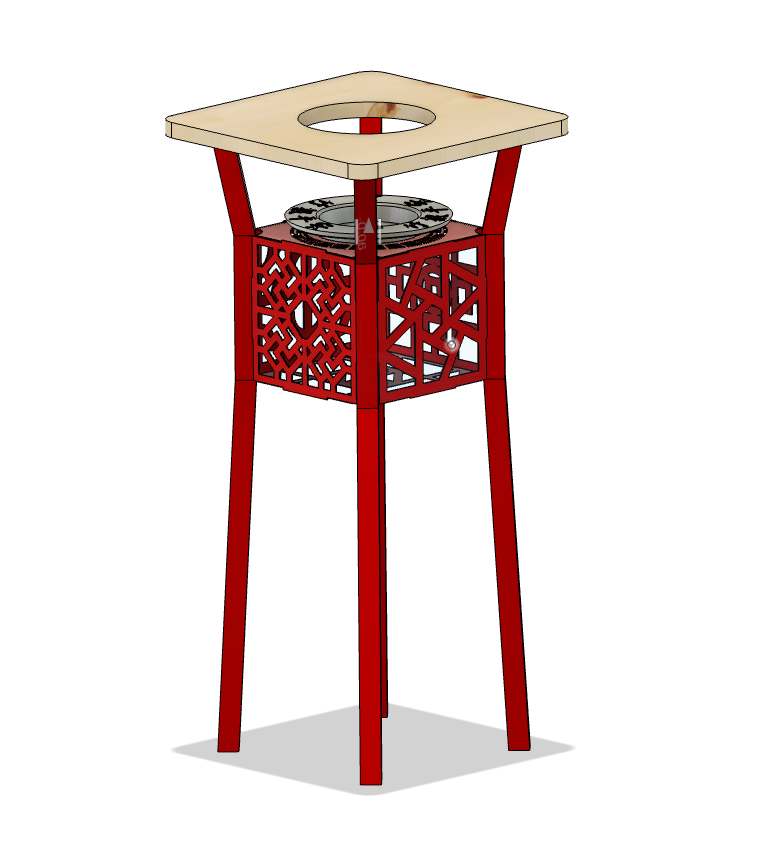
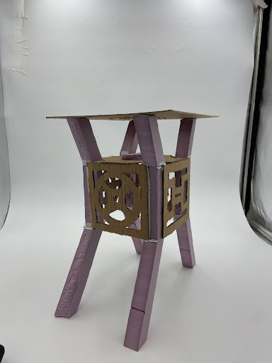
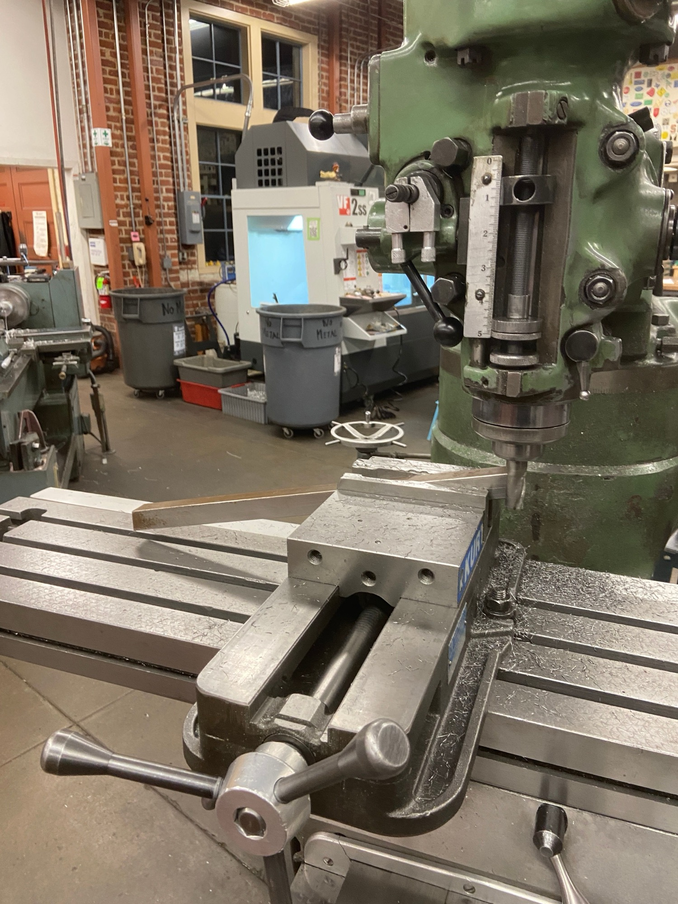
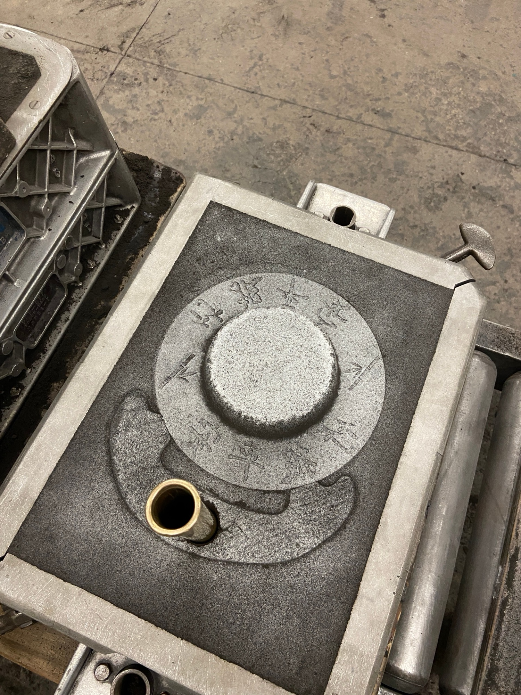
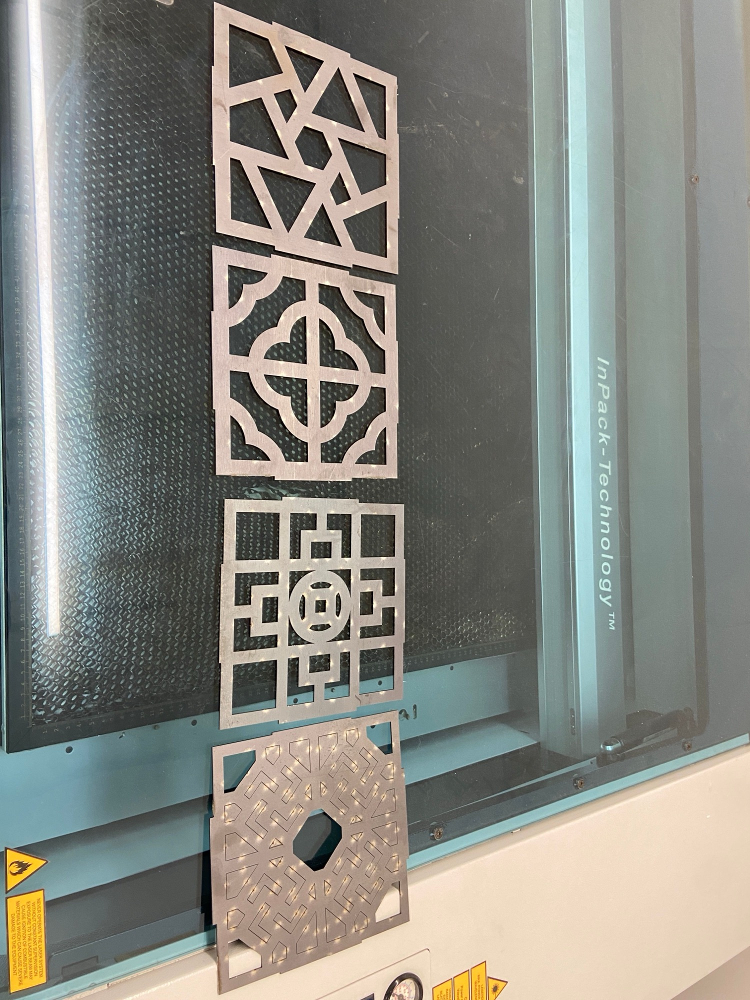
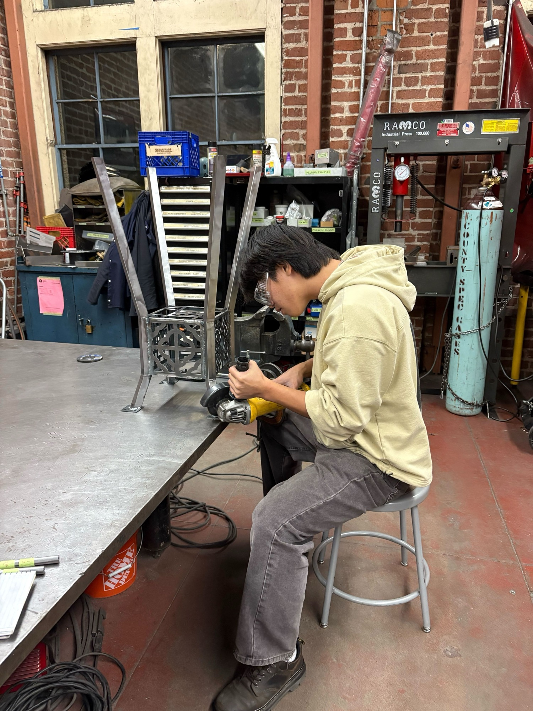
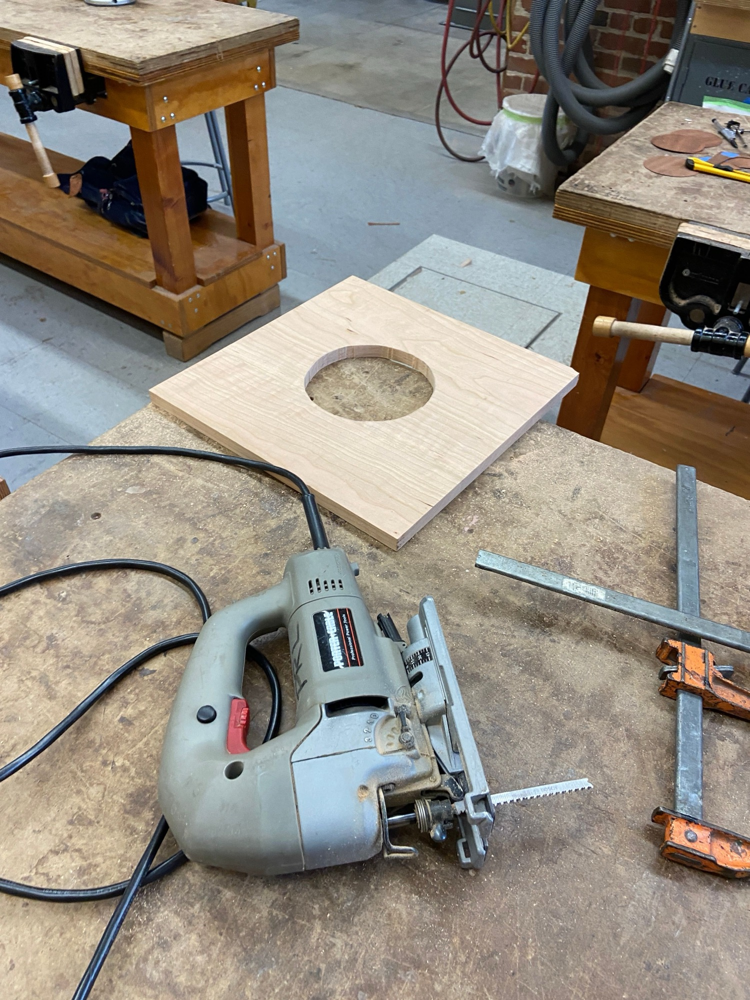
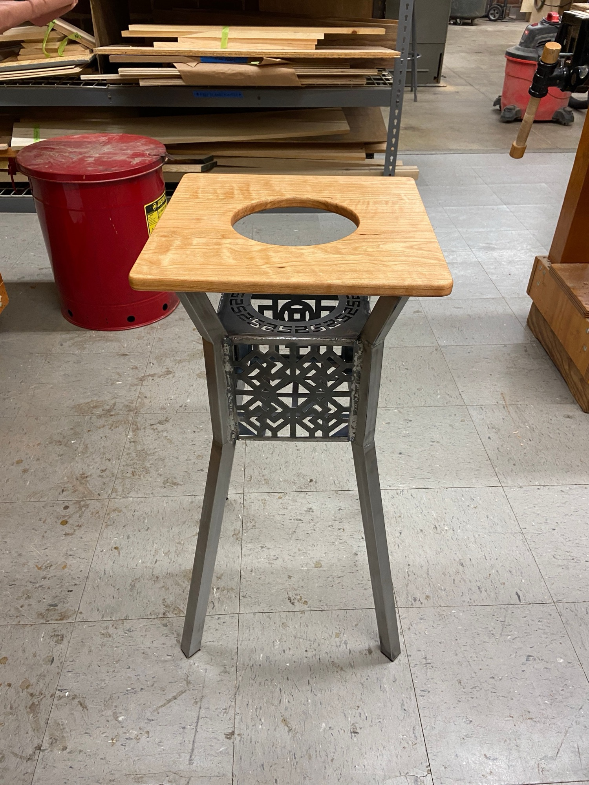
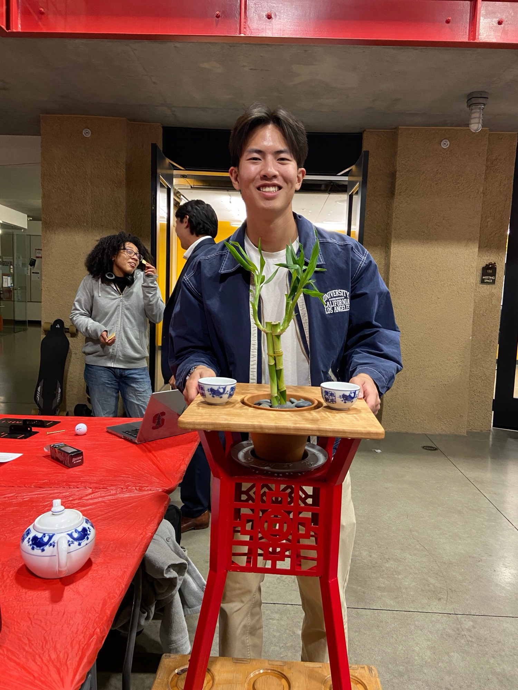

In Stanford's ME203: Design and Manufacturing, I designed and manufactured a small table that holds a planter pot in its center. The design was inspired by patterns found throughout Chinese tea gardens.

## CAD Models

The watering dish and the full table assembly were designed in Autodesk Fusion 360.

## Fabrication

*A first prototype of my table using foam and cardboard.*

*Milling the table leg ends using angle blocks to get the angle I wanted.*

*A ram-up of the watering dish for sand casting.*

*Laser-cut patterns of steel sheet metal for the center pot holder of my table legs.*

*Angle grinding down the welds of my mild steel table legs.*

*Cutting a center hole in my table top using a jigsaw and then a router.*

*Test assembly before finishing the table legs with spray paint.*

*Final result after assembly and finishing.*
