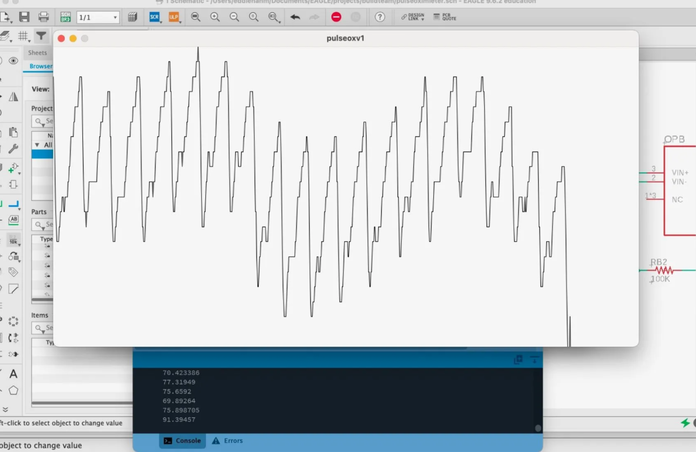
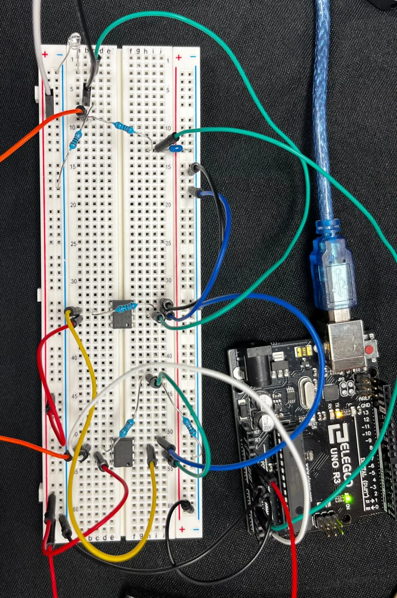
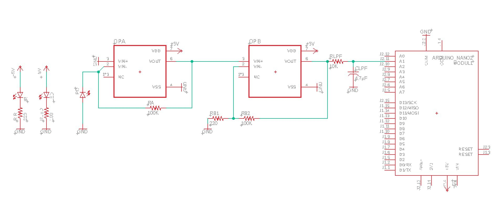
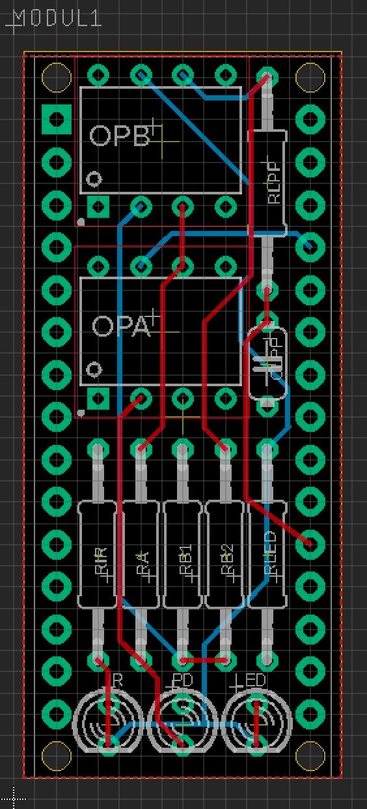
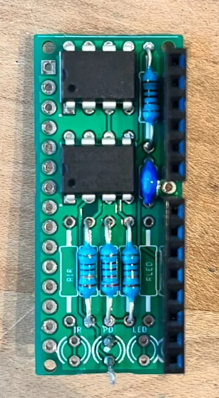
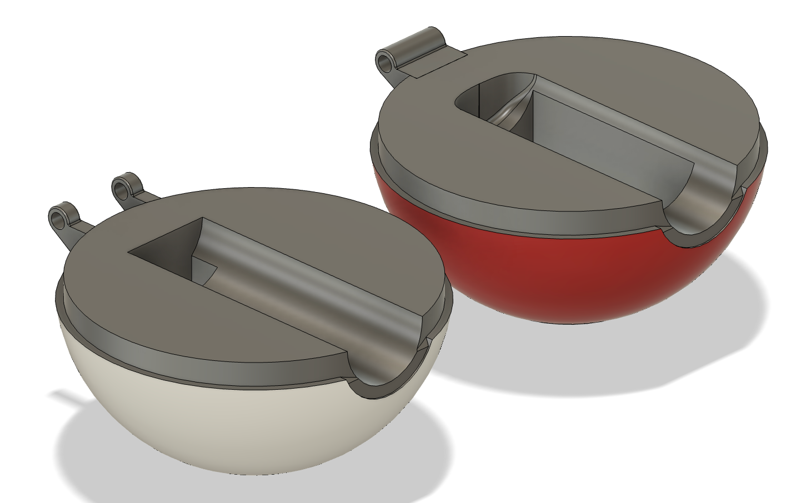
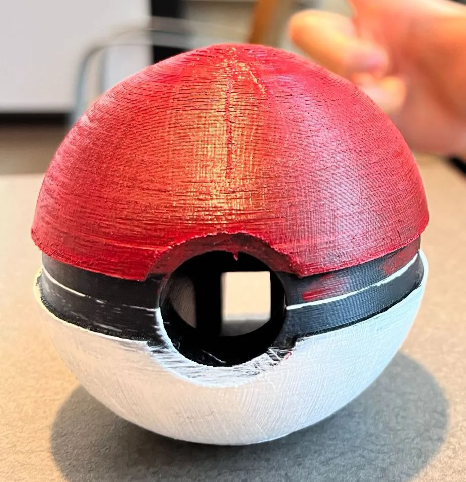
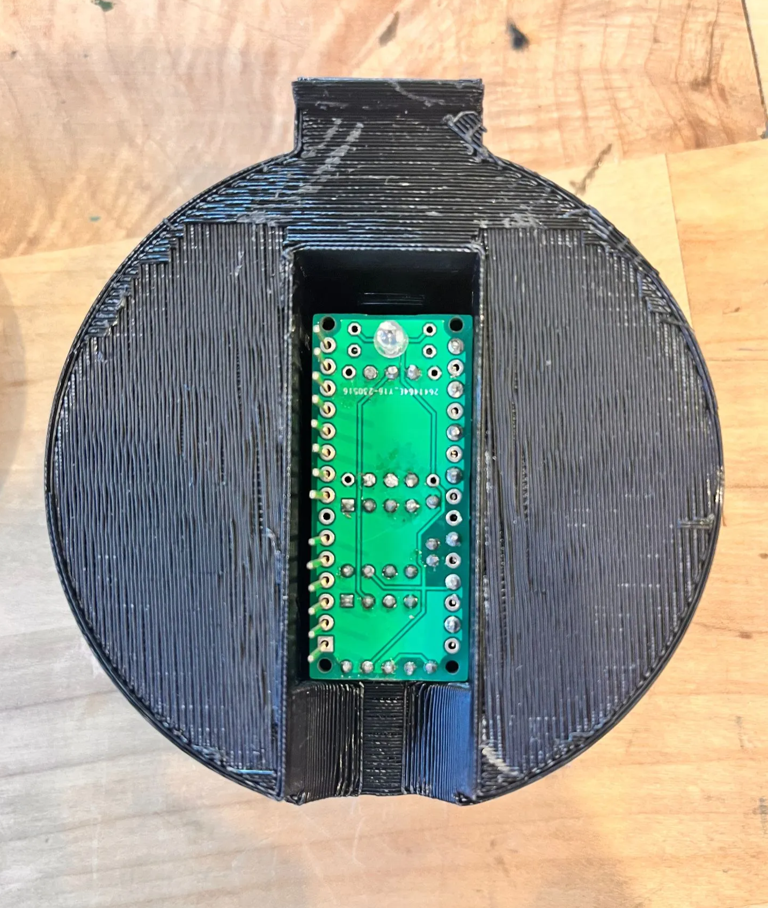

> A pulse oximeter is a medical device that measures your blood oxygen levels and pulse.

During my sophomore year, I built a pulse oximeter from scratch with a team of four, using circuitry, CAD, and software development. This project was part of the Biomedical Engineering Society (BMES) at UCLA's Build Team technical project.

*Pulse reading.*

We used Processing to handle the pulse signal and display the waveform in an easily readable way. The pulse rate was calculated with a peak-detection algorithm we developed. Here's a [real-time video](https://drive.google.com/file/d/1vm91t-d_Ll8JO2v1jZLxdfhqvfNx5zLc/view?usp=sharing).

*Breadboarded circuit.*

To detect the pulse, we used a red LED and a photodiode to capture absorbance, which changes with blood volume in the finger. The sensing circuit amplifies the signal with MCP6041 op-amps and filters it with capacitors, with an Arduino as the microcontroller. We breadboarded it first, then recreated it in EAGLE to make a printed circuit board.

*Circuit schematic.*

*PCB design.*

Once the PCB was printed, we soldered the components onto the board. The PCB was designed to sit on top of an Arduino Nano.

*Soldering in progress.*

The casing for the electronics was designed in Autodesk Fusion 360. We modeled it on the beloved Poké Ball, with a hole for users to insert their finger for a pulse reading.

*CAD of the casing.*

*Printed model.*

*PCB inserted into the casing.*

Our final device successfully read our pulse! We presented it at a Demo Day at the end of the school year alongside the other BMES technical projects.

*My team at our Demo Day!*
